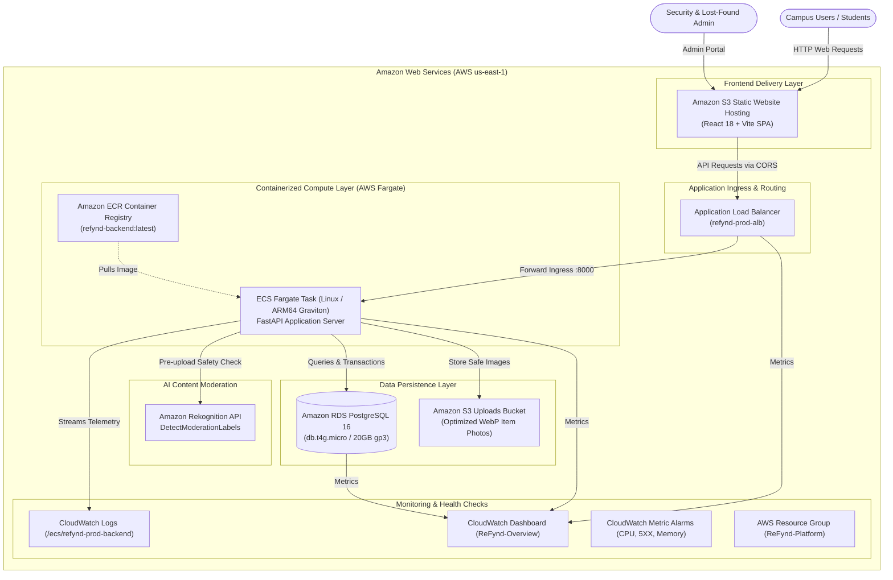

# ReFynd: Cloud Architecture, DevOps & Viva Defense Guide

This guide provides a comprehensive overview of the **Cloud Computing**, **DevOps Infrastructure**, and **Automated Pipelines** implemented for **ReFynd** (Campus Lost-and-Found Management System).

---

## 1. 🏗️ High-Level Cloud Architecture



---

## 2. 🔐 Understanding "Not Secure" (HTTP vs HTTPS) & CloudFront

### Why does the current S3 Website URL show "Not Secure"?
* When you open `http://refynd-frontend-prod-a91aeec0.s3-website-us-east-1.amazonaws.com`, modern browsers (Safari, Chrome) label it **"Not Secure"**.
* **Reason:** S3 Static Website Hosting natively serves over plain **HTTP** (port 80). Amazon S3 is an object storage service, not a TLS/SSL endpoint.
* **Is the application broken?** **No.** Every feature (listings, report creation, admin approval, database operations, image moderation) functions 100% normally.
* **How production systems fix this:** In standard AWS architecture, an **Amazon CloudFront CDN distribution** is deployed in front of the S3 bucket. CloudFront provides an automatic, free AWS SSL certificate (`https://*.cloudfront.net`) with a green padlock.

### Why is CloudFront currently on hold?
* During automated Terraform provisioning, AWS returned:
  `AccessDenied: Your account must be verified before you can add new CloudFront resources.`
* This is an automated anti-abuse restriction AWS places on **newly registered AWS accounts** to prevent CDN spam.
* **How to unlock HTTPS via CloudFront (1-minute process):**
  1. Open [AWS Support Center](https://console.aws.amazon.com/support/home#/case/create?issueType=customer-service&serviceCode=general-info&categoryCode=other).
  2. Select: **Account and billing support** → **General Info and Getting Started**.
  3. Subject: *Verification request for CloudFront distribution*.
  4. Body:
     > *"Hi AWS Support team, I am deploying a student college lost-and-found web project on AWS using S3 and CloudFront. Please verify my account so I can create a CloudFront CDN distribution. Thank you!"*
  5. Once AWS support approves it (usually within 12-24 hours), we enable `infra/terraform/cloudfront.tf.disabled` and run `terraform apply`. Your site will immediately be live on a secure `https://*.cloudfront.net` URL.

---

## 3. 💡 Core DevOps Concepts & Architectural Choices

### A. AWS Graviton ARM64 Compute
* **Why:** Both the backend Docker container and RDS database use **AWS Graviton2 (ARM64)** architecture (`db.t4g.micro` and `linux/arm64` Fargate).
* **Benefit:** Graviton processors deliver **up to 40% better price-performance** and consume significantly less power compared to legacy x86_64 processors.

### B. The \$32/Month NAT Gateway Optimization
* **The Problem:** The standard AWS textbook pattern places ECS containers in private subnets and routes their outbound internet traffic (to pull ECR images or call Rekognition) through an **AWS NAT Gateway**. However, AWS charges **\$0.045/hour + data fees**, costing **~\$32.85 to \$35 per month** even with zero traffic!
* **Our Solution:** We placed ECS Fargate tasks in public subnets with direct Internet Gateway access, **BUT** protected them with strict Security Group rules:
  * The ECS Security Group strictly rejects all direct internet traffic.
  * Inbound traffic on port 8000 is **ONLY accepted if it originates from the Application Load Balancer's Security Group**.
* **Result:** **\$0 NAT Gateway bill** with identical enterprise-grade perimeter isolation.

### C. Amazon Rekognition AI Content Moderation Pipeline
* **Fail-Closed Security:** Image moderation happens **before** any item photo is committed to the database or stored in S3.
* **Format Transcoding:** Rekognition strictly accepts JPEG or PNG byte streams. Our backend automatically decodes incoming uploads via Pillow, strips sensitive camera EXIF data (preventing geolocation leakage), and converts the image to clean JPEG bytes before calling `DetectModerationLabels`.
* **Threshold Enforcement:** If confidence for inappropriate categories (nudity, sexual content, violence) exceeds **70%**, the backend instantly rejects the request with HTTP 400.

### D. Multi-Stage Docker Builds
* **Frontend:** Built with a 2-stage Dockerfile (`node:20-alpine` build container -> `nginx:1.27-alpine` production runner). Keeps production image sizes under 25MB and prevents leaking source code or build tools.
* **Backend:** Built on `python:3.11-slim`, running under a dedicated non-root user (`appuser:1000`) for container runtime defense.

### E. Infrastructure as Code (Terraform)
* 100% of the AWS infrastructure is written as declarative code across modular Terraform files in `infra/terraform/`:
  * `vpc.tf`: Networking (VPC, subnets, route tables, IGW).
  * `security_groups.tf`: Least-privilege network firewalls.
  * `alb.tf`: Load balancing & target groups.
  * `ecs.tf`: Fargate tasks, clusters, and service definitions.
  * `rds.tf`: Managed PostgreSQL with auto-generated secure passwords.
  * `s3.tf`: Static website hosting & secure image storage.
  * `iam.tf`: Least-privilege IAM roles and execution policies.
  * `cloudwatch.tf`: Centralized logging, metric alarms, and SNS alerting.

---

## 4. 🚀 CI/CD Pipeline Automation (GitHub Actions)

Workflow file: `.github/workflows/ci.yml`

Whenever code is pushed to `main` or a pull request is opened:
1. **Backend Tests:** Installs Python 3.11, prepares an in-memory SQLite database, and runs `pytest` test suites.
2. **Frontend Build:** Installs Node.js 20, validates TypeScript types (`tsc`), and bundles Vite assets.
3. **Docker Verification:** Validates that both backend and frontend Docker containers build without errors.
4. **Automated Cloud Deployment (CD):** When AWS credentials (`AWS_ACCESS_KEY_ID`, `AWS_SECRET_ACCESS_KEY`) are present in GitHub Secrets, the pipeline automatically:
   * Emulates ARM64 and builds the container via Docker Buildx.
   * Pushes the image to Amazon ECR.
   * Issues an Amazon ECS rolling update (`--force-new-deployment`).
   * Syncs the compiled React assets to the frontend S3 bucket.

---

## 5. 🎓 College Viva / Presentation Defense Questions

#### Q1: Why did you use Amazon ECS with Fargate instead of hosting on an EC2 instance?
> *"On EC2, we are responsible for patching the Linux OS, managing security updates, configuring auto-scaling daemons, and paying for idle CPU capacity 24/7. ECS Fargate is serverless container compute: AWS manages the underlying virtual machines, isolates containers at the hypervisor level, and we only pay for the exact vCPU and RAM used by our container."*

#### Q2: How is the database secured if the application is accessible on the internet?
> *"The Amazon RDS PostgreSQL instance is deployed in isolated private subnets with `publicly_accessible = false`. It has no public IP address and no route to the internet. Its Security Group only accepts inbound traffic on port 5432 from the ECS Fargate Security Group. No one outside the VPC can connect to the database directly."*

#### Q3: How did you implement content moderation, and why is it important?
> *"In a campus lost-and-found portal, users upload photos of found items. To prevent abuse or inappropriate imagery, we integrated Amazon Rekognition's `DetectModerationLabels` API into the backend upload pipeline. The backend strips EXIF metadata, evaluates the image against safety categories, and rejects offensive uploads before they ever hit S3 or become visible to students."*

#### Q4: Why did you choose Amazon S3 for frontend hosting instead of serving it from the FastAPI backend?
> *"Separating frontend and backend follows microservices and single-responsibility principles. S3 static website hosting serves static HTML, JS, and CSS files with virtually 99.99% availability and zero compute overhead on our backend. This leaves our FastAPI backend 100% dedicated to API logic and database transactions."*

#### Q5: What is the purpose of Terraform state?
> *"Terraform maintains a state file (`terraform.tfstate`) that maps real-world AWS resources to our configuration code. When we run `terraform plan` or `apply`, Terraform compares the current state against AWS to determine the exact delta (additions, modifications, deletions) needed, ensuring infrastructure deployments are predictable and idempotent."*

---

## 6. 🧹 Cloud Teardown & Cleanup Instructions

To completely delete all AWS resources and prevent any ongoing cloud charges:

```bash
cd infra/terraform
terraform destroy -auto-approve
```

All 25 AWS components (RDS, ECS, ALB, S3 buckets, Security Groups, VPC) will be cleanly terminated.

