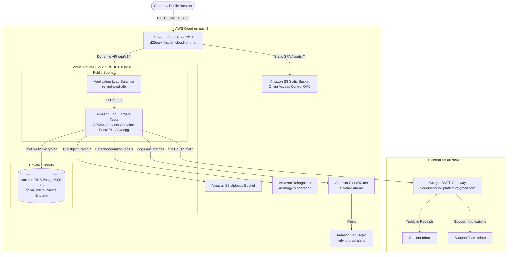

# ReFynd: Campus Lost-and-Found Management Platform

Live Production URL: https://d25eqjxhksqlbh.cloudfront.net

---

## Production Deployment Links

- Web Application Portal: https://d25eqjxhksqlbh.cloudfront.net
- Public Item Search: https://d25eqjxhksqlbh.cloudfront.net/search
- Report Lost Item: https://d25eqjxhksqlbh.cloudfront.net/report-lost
- Report Found Item: https://d25eqjxhksqlbh.cloudfront.net/report-found
- Private Report Tracking: https://d25eqjxhksqlbh.cloudfront.net/track
- Campus Help and Support: https://d25eqjxhksqlbh.cloudfront.net/support
- Admin and Staff Console: https://d25eqjxhksqlbh.cloudfront.net/admin/login

---

## Overview

ReFynd is a privacy-preserving, cloud-native lost-and-found management platform architected specifically for university campuses and educational institutions. It replaces fragmented paper registers and unstructured social media messaging groups with an automated, auditable digital clearinghouse.

The application couples a reactive Single-Page Application (SPA) frontend built with React 18, TypeScript, and Tailwind CSS with an asynchronous RESTful backend built with FastAPI and Python 3.11. The production system is containerized with Docker, automated with GitHub Actions CI/CD, and fully orchestrated on Amazon Web Services (AWS) using Terraform Infrastructure as Code (IaC).

---

## Key Features

1. Asymmetric Privacy Preservation
   Reporter contact information (email addresses and phone numbers) is encrypted and isolated from public catalog views. Listings display only sanitized item descriptors and physical holding desk locations.

2. Frictionless Token-Based Tracking
   Users can report lost or found items without mandatory upfront account registration. Upon submission, the platform generates a cryptographically unguessable tracking token and delivers a private management URL directly to the user's email inbox.

3. Automated AI Image Moderation
   Uploaded item photographs pass through a real-time, fail-closed safety pipeline powered by Amazon Rekognition (DetectModerationLabels). Any media flagged for explicit, suggestive, or inappropriate content with confidence greater than or equal to 70% is rejected immediately before permanent storage.

4. Multi-Attribute Matching Algorithm
   An automated matching engine cross-evaluates incoming lost and found listings across standardized categories, normalized brand tokens, fuzzy string distances (Levenshtein ratios), physical holding desk locations, and temporal proximity windows.

5. Support Ticketing and Real-Time Email Delivery
   Integrated support ticketing captures user inquiries, logs tickets into the PostgreSQL database, and forwards full details to cloudlostfound.platform@gmail.com with automated receipts sent to users via Google SMTP over TLS.

6. Application-Level Rate Limiting
   Token-bucket rate limiting enforced via SlowAPI protects endpoints from credential stuffing and automated abuse (10 requests/min for login, 5 requests/min for report creation, 3 requests/min for sensitive actions, 100 requests/min default).

---

## System Architecture



---

## Technology Stack

### Frontend
- Framework: React 18.2 with TypeScript 5.2
- Build Tool: Vite 5.0
- Styling: Tailwind CSS 3.3
- HTTP Client: Axios with normalized API client and request interceptors
- Icons: Lucide React
- Routing: React Router DOM v6 with CloudFront SPA custom error fallbacks

### Backend
- Framework: FastAPI 0.109 (ASGI)
- Language / Runtime: Python 3.11.8
- Web Server: Uvicorn 0.27
- Data Validation: Pydantic v2
- ORM: SQLAlchemy 2.0 (AsyncSession)
- Database Driver: Asyncpg 0.29
- Schema Migrations: Alembic 1.13
- Rate Limiting: SlowAPI 0.1.9 with Upstash Redis adapter support
- Image Processing: Pillow 10.2 (In-memory WebP/JPEG transcoding)
- Cloud SDK: Boto3 1.34

### Database and Infrastructure
- Database: Amazon RDS PostgreSQL 16.2 (Single-AZ, db.t4g.micro, gp3 storage)
- Container Orchestration: Amazon Elastic Container Service (ECS) Fargate
- Compute Architecture: 64-bit ARM64 (AWS Graviton)
- Container Registry: Amazon Elastic Container Registry (ECR)
- Edge CDN: Amazon CloudFront with Origin Access Control (OAC)
- Object Storage: Amazon S3 (Static Frontend and Uploads Buckets)
- AI Moderation: Amazon Rekognition
- Monitoring and Alarms: Amazon CloudWatch and Amazon SNS
- Infrastructure as Code: HashiCorp Terraform 1.7+

---

## Local Development and Containerization

### Prerequisites
- Docker Engine 24.0+ and Docker Compose v2+
- Node.js 20+ and Python 3.11+ (for local non-containerized workflows)

### Running the Complete Stack with Docker Compose
To launch the full multi-tier environment (PostgreSQL 16, FastAPI backend, and React/Nginx frontend) on your local machine:

```bash
docker compose up --build
```

Access points:
- Frontend Application: http://localhost:5173
- Backend API and Swagger Documentation: http://localhost:8000/docs
- Backend Health Probe: http://localhost:8000/health
- PostgreSQL Port: localhost:5433

---

## Automated Testing and CI/CD

The project includes an automated test suite executed via Pytest. The tests cover application health probes, Amazon Rekognition fail-closed moderation routines, and support ticket email dispatch pipelines.

### Running Tests Locally
```bash
cd backend
SECRET_KEY=test-secret-key-123456789 PYTHONPATH=. pytest -v
```

### GitHub Actions CI
All commits and pull requests target the `main` branch and trigger the workflow defined in `.github/workflows/ci.yml`. The pipeline installs dependencies, verifies code formatting, and runs all 18 unit and integration test cases.

---

## Cloud Infrastructure Management (Terraform)

All AWS cloud infrastructure is declared in modular Terraform configuration files located in `infra/terraform/`:

```
infra/terraform/
├── main.tf          # Provider configuration and global variables
├── vpc.tf           # VPC, public/private subnets, internet gateways, route tables
├── alb.tf           # Application Load Balancer, listeners, target groups
├── ecs.tf           # ECS Fargate task definitions (ARM64), cluster, services
├── rds.tf           # Amazon RDS PostgreSQL 16 instance and subnet groups
├── s3.tf            # S3 buckets for frontend distribution and media uploads
├── cloudfront.tf    # CloudFront distribution, cache behaviors, OAC, SPA error rules
└── cloudwatch.tf    # CloudWatch log group, 4 metric alarms, SNS alert topic
```

### Applying Infrastructure Updates
```bash
cd infra/terraform
terraform init
terraform plan
terraform apply
```

---

## Project Documentation

Detailed academic, operational, and architectural documentation is available in the repository:

- Formal B.Tech Final Project Report (95 Pages): `B_TECH_FINAL_PROJECT_REPORT.md`
- Modular Report Chapters: `docs/report/`
- Report Word and PDF Export Guide: `docs/EXPORT_GUIDE.md`
- AWS Cloud Deployment and Architecture Report: `AWS_DEPLOYMENT_REPORT.md`
- DevOps Operations and Architecture Guide: `DEVOPS.md`

---

## Directory Structure

```
.
├── B_TECH_FINAL_PROJECT_REPORT.md    # Formal 95-page engineering project thesis
├── AWS_DEPLOYMENT_REPORT.md         # AWS Cloud deployment and cost report
├── DEVOPS.md                        # DevOps and infrastructure guide
├── README.md                        # Project overview and quickstart
├── docker-compose.yml               # Local multi-service orchestration
├── backend/
│   ├── Dockerfile                   # Multi-stage ARM64 Graviton Python container
│   ├── entrypoint.sh                # DB readiness check and migration runner
│   ├── requirements.txt             # Pinned Python dependencies
│   ├── app/
│   │   ├── main.py                  # FastAPI factory and middleware pipeline
│   │   ├── api/v1/                  # RESTful API route controllers
│   │   ├── core/                    # Security, rate limiting, and config settings
│   │   ├── database/                # SQLAlchemy async engine and sessionmaker
│   │   ├── models/                  # Relational database models (PostgreSQL)
│   │   ├── schemas/                 # Pydantic v2 validation models
│   │   └── notifications/           # Asynchronous Google SMTP email service
│   └── tests/                       # Pytest test suites (18 tests passing)
├── frontend/
│   ├── Dockerfile                   # Multi-stage Node/Nginx container
│   ├── nginx.conf                   # Production Nginx reverse proxy configuration
│   ├── package.json                 # Node.js dependencies and scripts
│   └── src/
│       ├── App.tsx                  # Root component and client-side router
│       ├── components/              # Reusable UI components
│       ├── pages/                   # Application views (Search, Track, Report)
│       └── services/                # Axios API client with interceptors
├── infra/
│   └── terraform/                   # Production AWS Infrastructure as Code
└── docs/
    ├── EXPORT_GUIDE.md              # Instructions for Word and PDF generation
    └── report/                      # Modular chapters of the B.Tech thesis
```

---

## License and Academic Disclaimer

This project was developed for the Bachelor of Technology (B.Tech) degree in Computer Science and Engineering with specialization in Cloud Computing and DevOps at SRM Institute of Science and Technology. All rights reserved.
