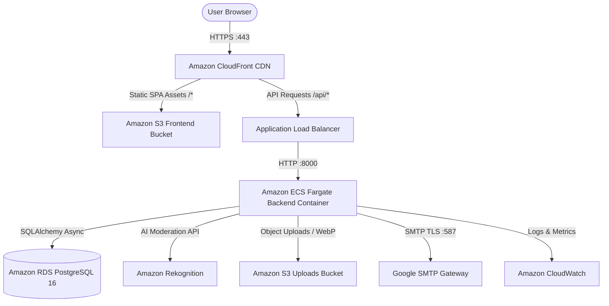

# ReFynd — Campus Item Recovery Platform

**Live Production Platform (AWS CloudFront HTTPS):** [https://d25eqjxhksqlbh.cloudfront.net](https://d25eqjxhksqlbh.cloudfront.net)

**Admin & Moderation Panel:** [https://d25eqjxhksqlbh.cloudfront.net/admin/login](https://d25eqjxhksqlbh.cloudfront.net/admin/login)

ReFynd is a secure, cloud-native item recovery platform built with FastAPI and React, fully deployed and orchestrated on **Amazon Web Services (AWS)** using Terraform Infrastructure as Code (IaC), Docker containerization, Amazon ECS Fargate (ARM64 Graviton), Amazon RDS PostgreSQL, Amazon CloudFront CDN, Amazon S3, and Amazon Rekognition AI moderation.

---

## Architecture & Technology Stack



- **Frontend:** React 18, TypeScript, Vite, TailwindCSS (Hosted via Amazon S3 + CloudFront CDN)
- **Backend:** Python 3.11, FastAPI, SQLAlchemy 2.0 (Asyncpg), Pydantic v2 (Containerized on Amazon ECS Fargate ARM64 Graviton)
- **Database:** Amazon RDS PostgreSQL 16 (`db.t4g.micro`, 20GB gp3, Multi-AZ subnets)
- **Object Storage:** Amazon S3 (`refynd-frontend-prod-a91aeec0` and `refynd-uploads-prod-a91aeec0`)
- **Content Delivery & HTTPS:** Amazon CloudFront Global CDN Distribution (`E2D6HFDGFXT0R5`) with automated SSL termination and HTTP-to-HTTPS redirect
- **AI Content Moderation:** Native Amazon Rekognition (`DetectModerationLabels`) with fail-closed security and Pillow JPEG transcoding
- **Observability:** Amazon CloudWatch centralized logging, 4 metric alarms (Backend CPU, Backend RAM, ALB 5xx errors, RDS CPU), and SNS alerting
- **Infrastructure as Code (IaC):** 100% Terraform managed ([`infra/terraform/`](file:///Users/ashuchaudhary/Downloads/lost-and-found-main/infra/terraform/))
- **Containerization:** Multi-stage production Dockerfiles with non-root user execution, custom entrypoint scripts, and Docker Compose local orchestration

---

## Containerization & Local Development

### Running via Docker Compose
The entire full-stack application (PostgreSQL 16, FastAPI backend, and React/Nginx frontend) can be spun up locally with a single command:

```bash
docker compose up --build
```
- Frontend: `http://localhost:5173`
- Backend API & Swagger Docs: `http://localhost:8000/docs`
- PostgreSQL: `localhost:5433`

---

## Detailed DevOps & Cloud Deployment Documentation
For detailed architectural blueprints, Terraform state diagrams, viva defense questions, and cost optimization calculations, refer to:
- [`DEVOPS.md`](file:///Users/ashuchaudhary/Downloads/lost-and-found-main/DEVOPS.md)
- [`AWS_DEPLOYMENT_REPORT.md`](file:///Users/ashuchaudhary/Downloads/lost-and-found-main/AWS_DEPLOYMENT_REPORT.md)


