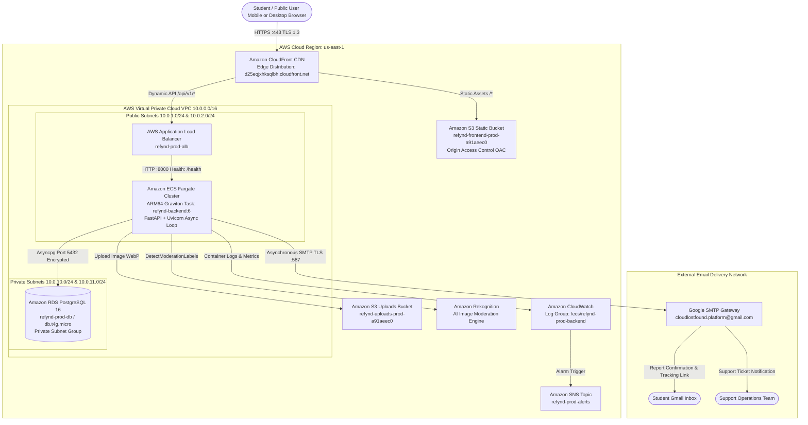
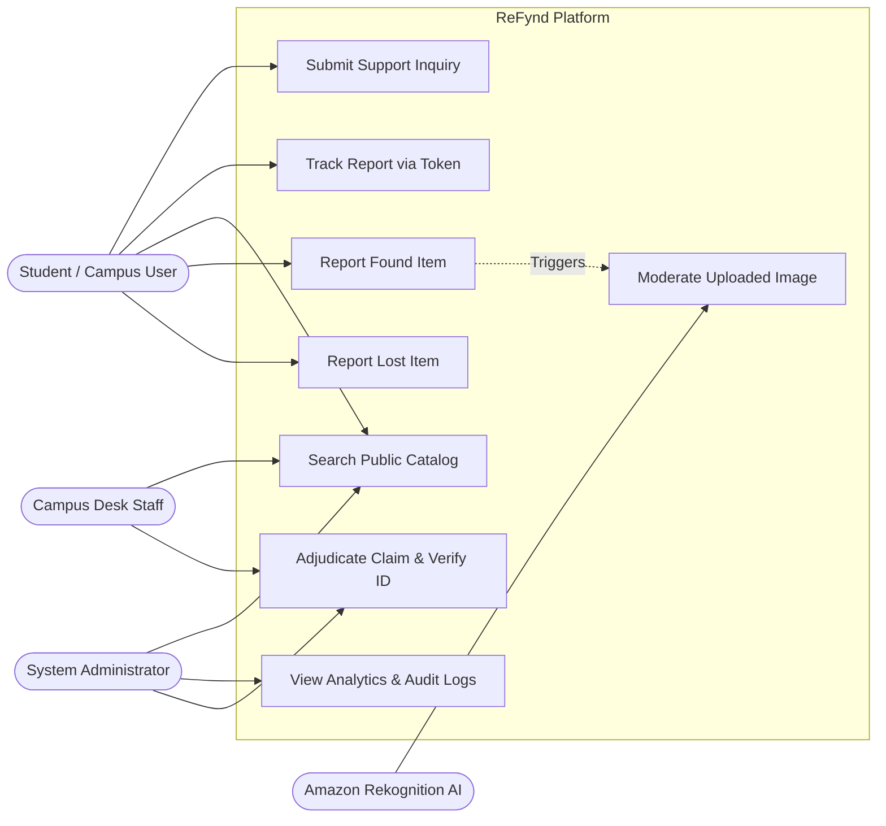
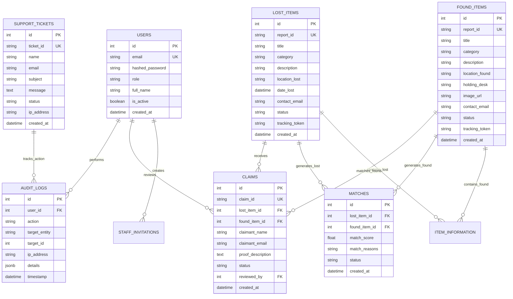

# CHAPTER 5
# SYSTEM DESIGN AND ARCHITECTURE

---

## 5.1 System Architecture Overview

The ReFynd platform is architected as an enterprise-grade, cloud-native, three-tier distributed web application designed for high availability, low latency, robust data protection, and seamless horizontal scalability. The architecture separates public static asset distribution, dynamic API request processing, transactional data persistence, and asynchronous background worker processing into decoupled, specialized subsystems.

The three primary tiers comprise:
1. **Presentation Tier (Client-Side Edge):**
   A reactive, Single-Page Application (SPA) built using React 18, TypeScript, and Tailwind CSS. The compiled static distribution (HTML5, JavaScript bundles, CSS stylesheets, and media assets) is hosted in an **Amazon S3** bucket and globally cached across hundreds of edge locations via the **Amazon CloudFront Content Delivery Network (CDN)** with strict TLS 1.3 termination.
2. **Application & Logic Tier (Containerized Compute):**
   A high-performance asynchronous RESTful API gateway engineered with **FastAPI and Python 3.11**, running inside an **Amazon Elastic Container Service (ECS) Fargate** serverless container environment. Compute workloads run on energy-efficient, high-performance 64-bit **ARM64 AWS Graviton** processors. Incoming web traffic is load-balanced across container tasks via an **Application Load Balancer (ALB)** residing within public subnets of an Amazon Virtual Private Cloud (VPC).
3. **Data Persistence & Integration Tier (Private Cloud Enclave):**
   An ACID-compliant relational persistence engine powered by **Amazon RDS PostgreSQL 16**, isolated inside private VPC subnets with zero public internet access. Static user media uploads are stored in a dedicated, secure **Amazon S3 Uploads Bucket** protected with pre-signed URLs and server-side encryption. External integrations include **Amazon Rekognition** for automated computer vision safety filtering and an authenticated **Google SMTP over TLS gateway** for physical email notifications.

---

## 5.2 High-Level Architecture Diagram

Figure 5.1 details the complete production cloud topology of the ReFynd platform on Amazon Web Services.


*Figure 5.1: Three-Tier High-Level Cloud Architecture of ReFynd on AWS*

### Ingress Traffic and Content Routing Logic:
1. When an end user initiates a web session at `https://d25eqjxhksqlbh.cloudfront.net`, DNS queries are resolved by Amazon CloudFront edge nodes closest to the user.
2. **Default Cache Behavior (`/*`):** CloudFront forwards requests for web assets (`index.html`, JavaScript, CSS) to the S3 frontend bucket via Origin Access Control (OAC). S3 bucket policies prevent any direct public internet access, ensuring all traffic traverses CloudFront edge caches.
3. **Single-Page Application (SPA) Custom Error Handling:** Because React Router handles client-side deep links (e.g., `/track?report_id=...` or `/report-found`), physical files do not exist at those S3 paths. CloudFront custom error response rules intercept HTTP 403 and HTTP 404 responses from S3, transparently rewriting them to `/index.html` with an HTTP 200 status code, enabling client-side hydration without broken page errors.
4. **Dynamic API Routing (`/api/*`):** CloudFront inspects incoming request paths. All paths matching `/api/*` bypass the static S3 cache and are forwarded directly to the Application Load Balancer origin with caching disabled, preserving query strings, cookies, and HTTP authorization headers.

---

## 5.3 Frontend Component Architecture

The frontend client is structured as a component-driven Single-Page Application (SPA) leveraging React 18 functional components, TypeScript interfaces, custom React hooks, and Context API for global state management.

```
src/
├── App.tsx                     # Master Root Component, Router Configuration, Global Layout
├── main.tsx                    # React DOM Mounting, QueryClient, Theme Initialization
├── types/                      # TypeScript Global Type Definitions
│   └── index.ts                # LostItem, FoundItem, Claim, User, Support Interfaces
├── services/                   # Asynchronous API Client Modules
│   └── api.ts                  # Axios Client Instance, Base URL Normalization, Interceptors
├── context/                    # React Context State Providers
│   └── AuthContext.tsx         # User Session, JWT Storage, Admin/Staff State
├── components/                 # Reusable Presentation and UI Components
│   ├── Navbar.tsx              # Responsive Navigation Bar with Mobile Drawer
│   ├── Footer.tsx              # Universal Institutional Footer & Support Link
│   ├── ItemCard.tsx            # Standardized Card View for Catalog Listings
│   ├── StepWizard.tsx          # Multi-Stage Form Indicator (Step 1 of 4)
│   ├── ImageUploader.tsx       # Drag-and-Drop Image Ingestion with Client Preview
│   └── ProtectedRoute.tsx      # RBAC Route Guard for Administrative Views
└── pages/                      # Top-Level Page Views (Route Targets)
    ├── Home.tsx                # Hero Banner, Quick Action Buttons, Recent Feed
    ├── ReportLost.tsx          # 4-Step Lost Item Ingestion Wizard
    ├── ReportFound.tsx         # 4-Step Found Item Ingestion Wizard
    ├── Search.tsx              # Debounced Search Engine with Multi-Facet Filters
    ├── TrackReport.tsx         # Token-Authenticated Private Item Dashboard
    ├── Support.tsx             # Interactive Campus Help & Support Ticket Form
    ├── Login.tsx               # Administrative & Staff JWT Authentication View
    └── AdminDashboard.tsx      # Unified Moderation, Claim, and Audit Console
```
*Figure 5.2: Frontend Component Hierarchy and Directory Layout*

### Key Frontend Architectural Principles:
* **Strict Type Safety:** All API request payloads and response bodies are strictly typed via TypeScript interfaces, preventing runtime property mismatch errors.
* **Debounced Reactive Querying:** The search view (`Search.tsx`) utilizes a custom `useDebounce` hook, buffering user keystrokes for 300 milliseconds before issuing API requests. This prevents network congestion and eliminates unnecessary backend database queries.
* **Universal Error Boundary & Fallbacks:** High-level React Error Boundaries intercept unhandled component exceptions, rendering a friendly recovery interface and logging diagnostic stack traces.

---

## 5.4 Backend Microservices Architecture

The backend application is structured as a modular ASGI microservice using **FastAPI**. FastAPI was chosen for its native asynchronous execution model built on Python’s `asyncio` event loop and Starlette framework, delivering industry-leading throughput under concurrent I/O workloads.

```
backend/
├── app/
│   ├── main.py                 # FastAPI Application Factory, CORS, Exception Handlers
│   ├── core/
│   │   ├── config.py           # Pydantic BaseSettings, Environment Variable Parsing
│   │   ├── security.py         # Password Hashing (Argon2/Bcrypt), JWT Encoding/Decoding
│   │   └── rate_limit.py       # SlowAPI Limiter Instance & Upstash Redis Storage Adapter
│   ├── database/
│   │   └── session.py          # SQLAlchemy 2.0 AsyncEngine, sessionmaker, get_db Dependency
│   ├── models/                 # SQLAlchemy Declarative Relational Models
│   │   ├── user.py             # User and Administrative Identity Model
│   │   ├── lost_item.py        # Lost Item Listing Model
│   │   ├── found_item.py       # Found Item Listing Model
│   │   ├── claim.py            # Ownership Claim Adjudication Model
│   │   ├── match.py            # Automated Similarity Match Model
│   │   ├── support_ticket.py   # Campus Support Ticket Model
│   │   └── audit.py            # Immutable Security Audit Log Model
│   ├── schemas/                # Pydantic v2 Serialization and Validation Models
│   │   ├── lost.py             # LostItemCreate, LostItemResponse Schemas
│   │   ├── found.py            # FoundItemCreate, FoundItemResponse Schemas
│   │   ├── claim.py            # ClaimCreate, ClaimReview Schemas
│   │   └── support.py          # SupportTicketCreate Schema
│   ├── api/v1/                 # Versioned RESTful API Route Controllers
│   │   ├── auth.py             # Authentication & Staff Management Endpoints
│   │   ├── lost_items.py       # Lost Item CRUD & Tracking Endpoints
│   │   ├── found_items.py      # Found Item CRUD & Image Upload Endpoints
│   │   ├── claims.py           # Claim Submission & Adjudication Endpoints
│   │   ├── search.py           # Multi-Facet Database Query Engine
│   │   ├── support.py          # Campus Support Ticket Ingestion Endpoint
│   │   └── admin.py            # Administrative Console & System Analytics
│   └── notifications/
│       └── service.py          # Asynchronous Google SMTP Email Dispatch Pipeline
├── Dockerfile                  # Production Multi-Stage ARM64 Docker Blueprint
├── entrypoint.sh               # Container Startup Script (Postgres Healthcheck + Migrations)
└── requirements.txt            # Explicitly Pinned Python Dependencies
```
*Figure 5.3: Backend Directory Structure and Architectural Layers*

### Asynchronous Request Lifecycle:
1. **Client Request Ingestion:** An incoming HTTP request arrives at Uvicorn via the Application Load Balancer.
2. **CORS & Rate Limiting Middleware:** The request traverses FastAPI middleware. The `CORSMiddleware` validates allowable origins (`https://d25eqjxhksqlbh.cloudfront.net`), and `SlowAPI` evaluates the client’s IP counter extracted from `X-Forwarded-For`.
3. **Dependency Injection:** Database sessions are provisioned on demand via `Depends(get_db)`, yielding a scoped `AsyncSession` that is automatically committed or rolled back upon endpoint exit.
4. **Pydantic Validation:** Request JSON payloads are parsed and validated against strict Pydantic schemas. If validation fails, an HTTP 422 Unprocessable Entity error is returned immediately with field-level diagnostics.
5. **Business Logic & Asynchronous Execution:** The route handler executes non-blocking asynchronous database queries via `await db.execute(...)`.
6. **Background Task Offloading:** Time-consuming operations—such as sending TLS SMTP emails or logging external audit records—are scheduled via FastAPI `BackgroundTasks`, allowing the endpoint to return an immediate HTTP 201 response to the client in under 50 milliseconds.

---

## 5.5 Database Architecture and VPC Placement

Data integrity, confidentiality, and network isolation are achieved by hosting the relational database within a segregated Amazon Virtual Private Cloud (VPC) topology:

* **VPC CIDR Block:** `10.0.0.0/16` deployed across two AWS Availability Zones (`us-east-1a` and `us-east-1b`).
* **Subnet Segmentation:**
  * **Public Subnets (`10.0.1.0/24`, `10.0.2.0/24`):** Host the public-facing Application Load Balancer.
  * **Private App Subnets (`10.0.10.0/24`, `10.0.11.0/24`):** Host the ECS Fargate container instances.
  * **Private Isolated DB Subnets (`10.0.20.0/24`, `10.0.21.0/24`):** Host the Amazon RDS PostgreSQL 16 instance.
* **Security Group Enclaves:**
  * The RDS Security Group strictly disallows all inbound traffic from the public internet. It accepts incoming TCP connections exclusively on port `5432` originating from the ECS Backend Security Group.
  * Even if an attacker discovers the internal DNS endpoint of the database, connection attempts from outside the private VPC are dropped at the hypervisor level.

---

## 5.6 Use-Case Modeling and Actor Specifications

The ReFynd ecosystem defines four primary human and automated actors:
1. **Student / General User:** Any enrolled student or campus visitor seeking to report a lost belonging, report a found item, query the catalog, or track a reported claim.
2. **Campus Desk Attendant (Staff):** Security desk wardens or custodial staff stationed at designated campus physical holding desks authorized to intake items, verify claimants, and release property.
3. **System Administrator:** University IT or Security Directors with full platform oversight, user role provisioning, system analytics access, and audit log inspection.
4. **Automated AI System (Amazon Rekognition):** Autonomous vision intelligence acting as a pre-storage safety gatekeeper.


*Figure 5.4: Comprehensive UML Use-Case Diagram for ReFynd System*

### Detailed Use-Case Specifications:

#### Use-Case UC-01: Report Lost Item
* **Primary Actor:** Student / General User.
* **Pre-conditions:** User has network connectivity to ReFynd web portal.
* **Flow of Events:**
  1. User accesses `/report-lost` and enters title, category, date/time lost, last seen location, and description.
  2. User specifies contact email and optional private verification proof (e.g., serial number).
  3. Client validates form fields and submits payload to `POST /api/v1/lost/create`.
  4. Backend assigns unique Report ID (`LF-SRM-26-XXXXXX`) and cryptographic tracking token.
  5. Backend queues confirmation email with tracking link via `BackgroundTasks`.
  6. Backend executes matching engine against active found items.
  7. Client receives HTTP 201 Created and displays confirmation screen with copyable Report ID.
* **Post-conditions:** Lost item record is committed to PostgreSQL with status `REPORTED`.

#### Use-Case UC-02: Report Found Item
* **Primary Actor:** Student (Finder) or Custodial Staff.
* **Flow of Events:**
  1. User accesses `/report-found` and inputs item attributes and holding desk location.
  2. User attaches optional photograph.
  3. Client uploads media bytes to `POST /api/v1/found/create`.
  4. Backend transcodes image to WebP, submits bytes to Amazon Rekognition `DetectModerationLabels`.
  5. If moderation flags confidence $\ge 70\%$, backend aborts and returns HTTP 400.
  6. If safe, image is committed to S3, record is saved to PostgreSQL, and confirmation email is dispatched.
* **Post-conditions:** Found item is visible in public search catalog with holding desk location.

---

## 5.7 Data Flow Diagrams (DFD)

The transformation of data across ReFynd is modeled through hierarchical Data Flow Diagrams.

### DFD Level 0: Context Diagram
Figure 5.5 models the entire ReFynd application as a single process, showing external entity data boundaries.

```
                       +-----------------------+
                       |    Student / User     |
                       +-------+-------+-------+
                               |       ^
            Lost/Found Details |       | Confirmation Email / Tracking Link
            Search Queries     |       | Public Search Results
                               v       |
                   +-----------+-------+-----------+
                   |                               |
                   |      ReFynd Platform          |
                   |       (Process 0.0)           |
                   |                               |
                   +-------+-------+-------+-------+
                           |       ^       |
         Image Bytes for   |       | Moderation Labels
         Safety Evaluation |       |
                           v       |
                   +-------+-------+-------+
                   |   Amazon Rekognition  |
                   |     AI Subsystem      |
                   +-----------------------+
```
*Figure 5.5: Data Flow Diagram (DFD) — Level 0 Context Diagram*

### DFD Level 1: Subsystem Interaction
Figure 5.6 decomposes Process 0.0 into major functional processes: Search & Cataloging, Report Ingestion & Validation, Claim Management, and Notification Dispatch.

```
[User] ---> (1.0 Ingest Report) ---> [DB: Staging] ---> (2.0 Image Moderation) ---> [AWS Rekognition]
                   |                                             |
                   v                                             v (Approved)
           [DB: Lost Items]                              [DB: Found Items]
                   ^                                             ^
                   |                                             |
[User] ---> (3.0 Search Engine) <--------------------------------+
                   |
                   v
[User] ---> (4.0 Submit Claim) ----> [DB: Claims] ----> (5.0 Admin Review) ---> [Staff]
                                                                |
                                                                v (Approved)
                                                      (6.0 Notification) ---> [User Email]
```
*Figure 5.6: Data Flow Diagram (DFD) — Level 1 Subsystem Interaction*

---

## 5.8 Entity-Relationship Diagram (ERD)

The data model is engineered to third normal form (3NF) to guarantee referential integrity and eliminate update anomalies. Figure 5.8 depicts the entities and relational cardinalities using Crow's Foot notation.


*Figure 5.8: Entity-Relationship Diagram (ERD) with Crow's Foot Cardinalities*

---

## 5.9 Detailed Database Schema and Data Dictionary

The following data dictionaries define the physical PostgreSQL table schemas, data types, constraints, and operational purposes.

### Table 5.1: `users` Table
Stores authenticated administrative and campus desk staff credentials and access roles.

| Column Name | Data Type | Constraints | Description |
| :--- | :--- | :--- | :--- |
| `id` | `INTEGER` | `PRIMARY KEY, AUTOINCREMENT` | Internal unique user surrogate identifier. |
| `email` | `VARCHAR(255)` | `UNIQUE, NOT NULL, INDEX` | Official institutional email address. |
| `hashed_password` | `VARCHAR(255)` | `NOT NULL` | Cryptographically hashed password (Argon2id/Bcrypt). |
| `full_name` | `VARCHAR(255)` | `NOT NULL` | Full name of the administrative user. |
| `role` | `VARCHAR(50)` | `NOT NULL, DEFAULT 'staff'` | Access role (`admin`, `staff`, `moderator`). |
| `is_active` | `BOOLEAN` | `NOT NULL, DEFAULT TRUE` | Active account status flag. |
| `created_at` | `TIMESTAMP WITH TZ` | `NOT NULL, DEFAULT UTC` | Timestamp of account registration. |

### Table 5.2: `lost_items` Table
Stores reports of misplaced belongings registered by students.

| Column Name | Data Type | Constraints | Description |
| :--- | :--- | :--- | :--- |
| `id` | `INTEGER` | `PRIMARY KEY, AUTOINCREMENT` | Surrogate primary key. |
| `report_id` | `VARCHAR(64)` | `UNIQUE, NOT NULL, INDEX` | Human-readable public identifier (e.g. `LF-SRM-26-8K4P91`). |
| `title` | `VARCHAR(255)` | `NOT NULL` | Brief name/title of the lost belonging. |
| `category` | `VARCHAR(100)` | `NOT NULL, INDEX` | Standardized category (Electronics, Keys, Wallet, etc.). |
| `description` | `TEXT` | `NOT NULL` | Full descriptive details of the item. |
| `location_lost` | `VARCHAR(255)` | `NOT NULL` | Campus building or zone where item was last seen. |
| `date_lost` | `TIMESTAMP WITH TZ` | `NOT NULL` | Approximate date and time of misplacement. |
| `contact_email` | `VARCHAR(255)` | `NOT NULL` | Owner’s email (strictly sequestered from public views). |
| `status` | `VARCHAR(50)` | `NOT NULL, DEFAULT 'REPORTED'`| Item lifecycle status (`REPORTED`, `MATCHED`, `CLAIMED`). |
| `tracking_token`| `VARCHAR(255)` | `NOT NULL, INDEX` | Cryptographic secret token required for status tracking. |
| `created_at` | `TIMESTAMP WITH TZ` | `NOT NULL, DEFAULT UTC` | Creation timestamp. |

### Table 5.3: `found_items` Table
Stores records of unattended items retrieved on campus.

| Column Name | Data Type | Constraints | Description |
| :--- | :--- | :--- | :--- |
| `id` | `INTEGER` | `PRIMARY KEY, AUTOINCREMENT` | Surrogate primary key. |
| `report_id` | `VARCHAR(64)` | `UNIQUE, NOT NULL, INDEX` | Public identifier (e.g. `FD-SRM-26-CSVSQM`). |
| `title` | `VARCHAR(255)` | `NOT NULL` | Item title / name. |
| `category` | `VARCHAR(100)` | `NOT NULL, INDEX` | Categorical classification. |
| `description` | `TEXT` | `NOT NULL` | Descriptive features and condition. |
| `location_found`| `VARCHAR(255)` | `NOT NULL` | Specific campus location where item was discovered. |
| `holding_desk` | `VARCHAR(255)` | `NOT NULL` | Physical security desk holding the item (e.g., Central Library).|
| `image_url` | `VARCHAR(512)` | `NULLABLE` | S3 URL of verified, moderated item photograph. |
| `contact_email` | `VARCHAR(255)` | `NOT NULL` | Finder’s email address (sequestered from public views). |
| `status` | `VARCHAR(50)` | `NOT NULL, DEFAULT 'AVAILABLE'`| Status (`AVAILABLE`, `CLAIMED`, `RESOLVED`, `ARCHIVED`). |
| `tracking_token`| `VARCHAR(255)` | `NOT NULL` | Secret tracking token for finder updates. |
| `created_at` | `TIMESTAMP WITH TZ` | `NOT NULL, DEFAULT UTC` | Ingestion timestamp. |

### Table 5.4: `claims` Table
Tracks formal ownership claims initiated by students.

| Column Name | Data Type | Constraints | Description |
| :--- | :--- | :--- | :--- |
| `id` | `INTEGER` | `PRIMARY KEY, AUTOINCREMENT` | Surrogate primary key. |
| `claim_id` | `VARCHAR(64)` | `UNIQUE, NOT NULL, INDEX` | Human-readable claim code (e.g. `CLM-2026-9X1Z`). |
| `lost_item_id` | `INTEGER` | `FOREIGN KEY (lost_items.id)` | Optional link to claimant’s lost report. |
| `found_item_id`| `INTEGER` | `FOREIGN KEY (found_items.id)`| Target found item being claimed. |
| `claimant_name` | `VARCHAR(255)` | `NOT NULL` | Full legal name of student claiming ownership. |
| `claimant_email`| `VARCHAR(255)` | `NOT NULL` | Student institutional email address. |
| `proof_details` | `TEXT` | `NOT NULL` | Private proof of ownership submitted for verification. |
| `status` | `VARCHAR(50)` | `NOT NULL, DEFAULT 'PENDING'` | Status (`PENDING`, `APPROVED`, `REJECTED`). |
| `reviewed_by` | `INTEGER` | `FOREIGN KEY (users.id), NULL` | Staff member who adjudicated the claim. |
| `created_at` | `TIMESTAMP WITH TZ` | `NOT NULL, DEFAULT UTC` | Submission timestamp. |

### Table 5.5: `support_tickets` Table
Stores inquiries and bug reports submitted through the platform.

| Column Name | Data Type | Constraints | Description |
| :--- | :--- | :--- | :--- |
| `id` | `INTEGER` | `PRIMARY KEY, AUTOINCREMENT` | Surrogate primary key. |
| `ticket_id` | `VARCHAR(64)` | `UNIQUE, NOT NULL, INDEX` | Human-readable ticket ID (e.g. `SUP-2026-2DZMKN`). |
| `name` | `VARCHAR(255)` | `NOT NULL` | Submitter full name. |
| `email` | `VARCHAR(255)` | `NOT NULL` | Submitter contact email. |
| `subject` | `VARCHAR(255)` | `NOT NULL` | Ticket category or inquiry subject. |
| `message` | `TEXT` | `NOT NULL` | Full description of inquiry or technical issue. |
| `status` | `VARCHAR(50)` | `NOT NULL, DEFAULT 'OPEN'` | Status (`OPEN`, `IN_PROGRESS`, `RESOLVED`, `CLOSED`). |
| `ip_address` | `VARCHAR(64)` | `NOT NULL` | Client remote IP address captured for audit safety. |
| `created_at` | `TIMESTAMP WITH TZ` | `NOT NULL, DEFAULT UTC` | Ticket creation timestamp. |

---

## 5.10 RESTful API Architecture and OpenAPI Contracts

ReFynd enforces a uniform RESTful API contract. All endpoints return standardized JSON payloads adhering to OpenAPI 3.0 conventions, outlined in Table 5.7.

*Table 5.7: Core RESTful API Routes and HTTP Method Matrix*

| HTTP Method | API Route | Access Control | Rate Limit | Primary Purpose |
| :--- | :--- | :--- | :--- | :--- |
| `GET` | `/health` | Public | None | Container health check probing database connectivity. |
| `POST` | `/api/v1/auth/login` | Public | 10/min | Authenticates staff; returns signed JWT Bearer Token. |
| `GET` | `/api/v1/search` | Public | 100/min | Debounced full-text search with category & location filters. |
| `POST` | `/api/v1/lost/create` | Public | 5/min | Registers a lost item report; triggers confirmation email. |
| `GET` | `/api/v1/track/{report_id}`| Public (Token Gate) | 100/min | Returns private report details if valid token supplied. |
| `POST` | `/api/v1/found/create` | Public | 5/min | Ingests found report, moderates image, saves to S3. |
| `POST` | `/api/v1/claims` | Public | 5/min | Submits private ownership proof claiming a found item. |
| `GET` | `/api/v1/admin/claims` | Staff / Admin | 100/min | Lists all pending claims awaiting physical verification. |
| `POST` | `/api/v1/admin/claims/{id}`| Staff / Admin | 10/min | Approves or rejects a claim; updates item lifecycle status. |
| `POST` | `/api/v1/support` | Public | 5/min | Logs support ticket and forwards email to platform admin. |

---

## 5.11 Multi-Layer Defense-in-Depth Security Architecture

Security is architected into ReFynd at every physical, network, and application boundary, adhering to the principle of Defense-in-Depth illustrated in Figure 5.9:

```
[Layer 1: Edge & Perimeter]   -> CloudFront TLS 1.3 Termination + AWS Shield Standard (DDoS)
[Layer 2: Network Gateways]   -> Application Load Balancer Security Groups + VPC Subnet Isolation
[Layer 3: Application Layer]  -> SlowAPI Rate Limiting + CORS Whitelist + Pydantic Strict Typing
[Layer 4: Logic & Media Gate] -> Amazon Rekognition Fail-Closed AI Moderation (Confidence >= 70%)
[Layer 5: Auth & Identity]    -> JWT Bearer Tokens + Argon2 Password Hashing + RBAC Guards
[Layer 6: Persistence Layer]  -> Private Subnet RDS Enclave + KMS AES-256 Encryption at Rest
```
*Figure 5.9: Multi-Layer Defense-in-Depth Security Architecture*

1. **Edge Mitigation:** CloudFront negotiates HTTPS with modern ciphers (TLS 1.3), deflecting volumetric Layer 3/4 DDoS attacks via AWS Shield Standard.
2. **Network Enclave:** Containers execute in private subnets. The PostgreSQL database is completely unreachable from the public internet, accepting connections only from the ECS task security group on port 5432.
3. **Application Hardening:** SlowAPI limits request bursts by IP address. Pydantic sanitizes all input strings, completely immunizing the system against SQL injection (SQLAlchemy parameterized queries) and Cross-Site Scripting (XSS).
4. **Data Isolation:** All personal contact details are stored in restricted relational tables; public queries select only non-PII fields.
