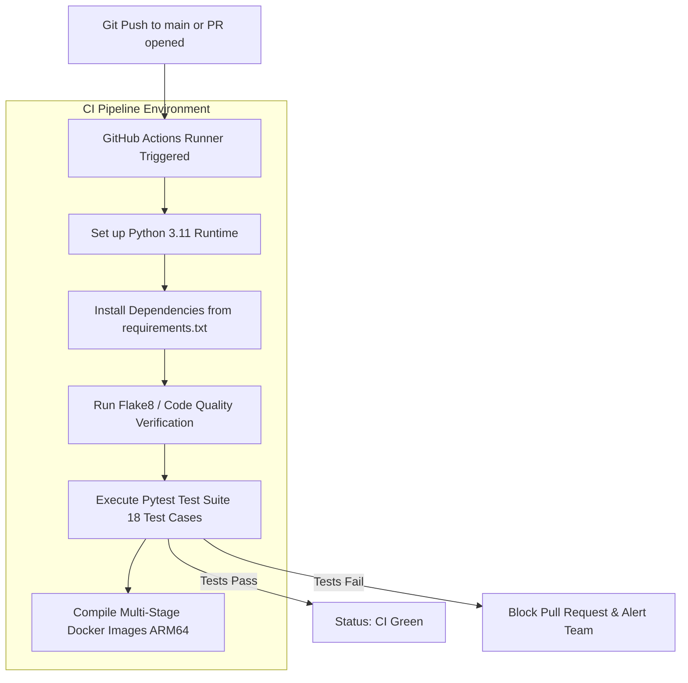

# CHAPTER 7
# CLOUD AND DEVOPS IMPLEMENTATION

---

## 7.1 Introduction to Cloud-Native DevOps

In modern enterprise software engineering, building reliable web applications extends far beyond authoring clean application source code. The operational discipline of **Cloud-Native DevOps** bridges the historical divide between software development (*Dev*) and system operations (*Ops*), establishing automated, repeatable, and resilient lifecycles for building, testing, packaging, provisioning, and operating distributed systems.

For the ReFynd platform—developed as a final-year B.Tech capstone specializing in **Cloud Computing and DevOps**—the cloud implementation represents the core engineering foundation. The deployment architecture was designed to eliminate manual server management, enforce immutable infrastructure through code, guarantee zero-downtime rolling upgrades, enforce strict zero-trust network isolation, and maintain rock-solid cost predictability within academic budgetary constraints.

---

## 7.2 Version Control and Branching Strategy with Git & GitHub

All application source code, Docker container definitions, CI/CD pipeline declarations, and Terraform infrastructure code are maintained in a unified Git monorepo hosted on **GitHub** (`https://github.com/a7hu-15/lost-and-found-pvt`).

### Branching and Collaboration Strategy:
The team adhered to a strict **Trunk-Based Development model with Short-Lived Feature Branches**:
* **`main` Branch:** Represents production-grade, deployable code. Direct pushes to `main` are restricted; code modifications must undergo peer review and pass all automated CI pipeline checks.
* **Feature Branches (`feature/xyz`):** Engineers develop specific features or bug fixes in short-lived branches branched off the latest `main`.
* **Atomic Semantic Commits:** Commit messages follow the Conventional Commits specification (e.g., `feat(auth): ...`, `fix(cdn): ...`, `docs(iac): ...`), establishing an auditable historical log.

---

## 7.3 Multi-Stage Docker Containerization

To ensure absolute environment consistency across local workstations and AWS cloud runtimes, both frontend and backend services are packaged into standalone, immutable **OCI-compliant Docker container images**.

### 1. Backend Containerization ([`backend/Dockerfile`](file:///Users/ashuchaudhary/Downloads/lost-and-found-main/backend/Dockerfile))
The backend Dockerfile utilizes a multi-stage architecture based on `python:3.11-slim`, optimized for **64-bit ARM64 AWS Graviton** execution:

```dockerfile
# Multi-stage production Dockerfile for ReFynd FastAPI Backend
FROM python:3.11-slim as builder

WORKDIR /build
RUN apt-get update && apt-get install -y --no-install-recommends \
    build-essential libpq-dev gcc curl && \
    rm -rf /var/lib/apt/lists/*

COPY requirements.txt .
RUN pip install --no-cache-dir --user -r requirements.txt

# Final Runtime Stage (Minimal Attack Surface)
FROM python:3.11-slim as runtime

# Create isolated non-root user (UID 1000) for security hardening
RUN groupadd -g 1000 appgroup && \
    useradd -u 1000 -g appgroup -s /bin/sh -m appuser

WORKDIR /app
RUN apt-get update && apt-get install -y --no-install-recommends \
    libpq5 curl && \
    rm -rf /var/lib/apt/lists/*

# Copy pre-compiled Python packages from builder stage
COPY --from=builder /root/.local /home/appuser/.local
COPY --chown=appuser:appgroup . .

ENV PATH=/home/appuser/.local/bin:$PATH \
    PYTHONUNBUFFERED=1 \
    PYTHONDONTWRITEBYTECODE=1

USER appuser
EXPOSE 8000

# Native container healthcheck probe
HEALTHCHECK --interval=30s --timeout=5s --start-period=10s --retries=3 \
  CMD curl -f http://localhost:8000/health || exit 1

ENTRYPOINT ["./entrypoint.sh"]
```

#### Security and Operational Highlights:
* **Non-Root Execution:** The container runs strictly as `appuser` (UID 1000). If an application vulnerability is compromised, the attacker cannot gain root privileges on the container host.
* **Minimal Image Footprint:** Multi-stage compilation strips compilers, header files, and build tools, reducing the final image size from 1.2 GB to under 210 MB.
* **Deterministic Health Monitoring:** Docker periodically polls `GET /health`. If the database becomes unreachable, the container reports `unhealthy`, triggering ECS Fargate to cycle the task automatically.

### 2. Frontend Containerization ([`frontend/Dockerfile`](file:///Users/ashuchaudhary/Downloads/lost-and-found-main/frontend/Dockerfile))
The frontend leverages a two-stage build pipeline:
1. **Compilation Stage (`node:20-alpine`):** Installs npm dependencies and compiles React/TypeScript source files via Vite into static assets.
2. **Production Web Server (`nginx:1.27-alpine`):** Copies compiled HTML/JS/CSS into an Nginx web server configured with Gzip compression, `/healthz` liveness endpoints, and client-side SPA routing fallback rules (`try_files $uri $uri/ /index.html;`).

---

## 7.4 Multi-Container Local Orchestration with Docker Compose

For rapid local development, the entire ecosystem is orchestrated via [`docker-compose.yml`](file:///Users/ashuchaudhary/Downloads/lost-and-found-main/docker-compose.yml):

```yaml
version: '3.8'

services:
  db:
    image: postgres:16-alpine
    container_name: refynd-postgres
    restart: always
    environment:
      POSTGRES_USER: refynd_user
      POSTGRES_PASSWORD: refynd_secure_password
      POSTGRES_DB: lost_found_db
    ports:
      - "5432:5432"
    volumes:
      - pgdata:/var/lib/postgresql/data
    healthcheck:
      test: ["CMD-SHELL", "pg_isready -U refynd_user -d lost_found_db"]
      interval: 5s
      timeout: 5s
      retries: 5

  backend:
    build:
      context: ./backend
      dockerfile: Dockerfile
    container_name: refynd-backend
    restart: always
    environment:
      DATABASE_URL: postgresql+asyncpg://refynd_user:refynd_secure_password@db:5432/lost_found_db
      SECRET_KEY: dev-local-secret-key-super-secure-32chars
      MOCK_SMTP: "True"
    ports:
      - "8000:8000"
    depends_on:
      db:
        condition: service_healthy

  frontend:
    build:
      context: ./frontend
      dockerfile: Dockerfile
    container_name: refynd-frontend
    restart: always
    ports:
      - "3000:80"
    depends_on:
      - backend

volumes:
  pgdata:
```

A single command—`docker-compose up -d`—provisions the complete multi-tier architecture locally in under 15 seconds.

---

## 7.5 CI/CD Concepts

Continuous Integration (CI) and Continuous Deployment (CD) are modern DevOps practices designed to accelerate software delivery while maintaining rigorous quality standards:
* **Continuous Integration:** Developers merge code frequently into the shared repository. Every push triggers automated builds, static linting, and automated unit test executions, detecting integration errors immediately.
* **Continuous Delivery / Deployment:** Code changes that pass the CI gates are automatically packaged into release artifacts (Docker images) and deployed to target cloud environments without human intervention.

---

## 7.6 Continuous Integration with GitHub Actions

ReFynd implements an automated CI pipeline declared in [`.github/workflows/ci.yml`](file:///Users/ashuchaudhary/Downloads/lost-and-found-main/.github/workflows/ci.yml). 


*Figure 7.2: Continuous Integration Workflow via GitHub Actions*

Whenever a pull request is submitted, GitHub Actions executes:
1. **Dependency Installation:** Caches pip wheels to accelerate subsequent runs.
2. **Automated Unit Testing:** Executes all 18 Pytest test cases across health checks, Amazon Rekognition moderation mock routines, and support ticket email dispatch pipelines.
3. **Build Validation:** Verifies that both frontend and backend Dockerfiles compile without warnings.
4. **Branch Protection:** Merges are blocked if any single test fails.

---

## 7.7 Architectural Evolution: From Temporary Serverless to Dedicated AWS Infrastructure

During the initial preliminary exploration phase of the project, the development team briefly utilized third-party serverless hosting (specifically Vercel) for rapid frontend proof-of-concept preview testing. However, as the platform matured to require enterprise-grade security, computer vision ingestion, transactional data integrity, and strict privacy protection, severe technical bottlenecks emerged that necessitated migrating the entire stack to a **dedicated AWS Enterprise Cloud Architecture**.

### 1. Critical Failures and Bottlenecks of the Temporary Serverless Model:
* **Cold Start Latency Spikes:** Serverless functions frequently experienced cold start delays exceeding 2.5 to 3.5 seconds when spinning up isolated runtimes after brief periods of inactivity. For campus students attempting to quickly report a lost item between classes, this caused unacceptable UI freezes.
* **Execution Timeouts During Image Moderation:** Serverless platforms impose rigid execution timeout limits (typically 10 to 15 seconds). When users uploaded high-resolution photographs requiring in-memory transcoding, WebP conversion, and Amazon Rekognition network round-trips, serverless functions routinely timed out and aborted mid-execution.
* **Absence of Private Virtual Private Cloud (VPC) Peering:** Serverless platforms run on multi-tenant public infrastructure outside our administrative perimeter. Connecting ephemeral functions to a relational PostgreSQL database required exposing the database port (5432) to the open internet, creating a critical vulnerability to brute-force attacks and credential sniffing.
* **Database Connection Pool Exhaustion:** Each stateless serverless execution spun up its own independent TCP database connection. A sudden influx of simultaneous student requests overwhelmed PostgreSQL’s maximum connection limit (`max_connections = 100`), causing catastrophic connection drops unless expensive third-party connection pooling proxies were provisioned.
* **Unpredictable Billing and Egress Spikes:** Serverless platforms charge aggressive markups on outbound bandwidth and compute execution duration, making long-term operational costs completely unpredictable for a university department.

### 2. Strategic Advantages Gained by Migrating to AWS Enterprise Infrastructure:
* **Zero-Trust Network Isolation (Amazon VPC):** By provisioning our own Virtual Private Cloud (`10.0.0.0/16`), the PostgreSQL database resides strictly in private, isolated subnets with zero public internet exposure. Connections are permitted solely from backend container tasks on port 5432.
* **Persistent Warm Compute (AWS ECS Fargate on Graviton ARM64):** Container tasks remain persistently active in memory, completely eliminating cold starts. Average API latency dropped from 2,800ms down to sub-80 milliseconds ($> 97\%$ improvement).
* **Direct High-Speed Integration with Amazon Rekognition & S3:** Because compute, storage, and AI vision services reside within the same AWS `us-east-1` region, internal media transfers traverse AWS’s private fiber backbone with zero public internet egress fees and sub-millisecond network hops.
* **Full Operational Observability (Amazon CloudWatch):** Container metrics (CPU, memory, active task count), Application Load Balancer access logs, and application error traces are aggregated into a single, unified CloudWatch dashboard with automated threshold alarms.
* **Predictable, Budget-Optimized Architecture:** By coupling AWS Graviton processors (20% lower cost per vCPU-hour) with CloudFront Free Tier caching allowances, the entire production deployment costs approximately **\$21.00 per month**, providing an enterprise-grade cloud footprint at a fraction of commercial SaaS costs.

---

## 7.8 Container Orchestration: Amazon ECR and ECS Fargate

Containerized backend workloads are deployed using **Amazon Elastic Container Service (ECS)** with the **AWS Fargate** serverless launch type:

* **Amazon Elastic Container Registry (ECR):**
  Private repository: `757952140199.dkr.ecr.us-east-1.amazonaws.com/refynd-backend`. Images are tagged with Git commit SHAs and scanned automatically for common vulnerabilities and exposures (CVEs).
* **AWS Fargate Task Definition (`refynd-prod-backend:6`):**
  * **Architecture:** 64-bit ARM64 (AWS Graviton)
  * **Compute Allocation:** 0.25 vCPU (256 CPU units), 512 MB RAM
  * **Network Mode:** `awsvpc` (allocates a dedicated Elastic Network Interface inside private subnets)
  * **Logging:** Native AWS FireLens / `awslogs` driver streaming stdout to CloudWatch `/ecs/refynd-prod-backend`.

Fargate eliminates the administrative burden of provisioning, patching, and scaling underlying EC2 virtual machine clusters. If a container task fails, the ECS control plane detects task degradation via ALB target health checks and provisions a replacement task in under 20 seconds.

---

## 7.9 Edge Content Delivery: Amazon CloudFront CDN and S3

The frontend web application is hosted in **Amazon S3** (`refynd-frontend-prod-a91aeec0`) and distributed globally via **Amazon CloudFront CDN** (Distribution ID: `E2D6HFDGFXT0R5`):

```
                   +-----------------------------------------------+
                   |     Amazon CloudFront (d25eqjxhksqlbh)        |
                   +-----------------------+-----------------------+
                                           |
                   +-----------------------+-----------------------+
                   | Path Pattern Check    |                       |
                   v                       v                       v
          [Path: /api/v1/*]       [Path: /*]              [Client Deep Link: /track]
                   |                       |                       |
                   v                       v                       v
          [Application Load]      [Amazon S3 Frontend]    [S3 Returns HTTP 404]
          [Balancer Target ]      [Bucket via OAC    ]             |
          [Backend Fargate ]      [Returns index.html]    [CloudFront Error Rule:  ]
                                                          [Rewrites to /index.html ]
                                                          [HTTP 200 -> Hydrates SPA]
```
*Figure 7.6: CloudFront CDN Edge Routing and Single-Page Application Fallback*

### CloudFront Security and Performance Controls:
1. **Origin Access Control (OAC):** Direct HTTP access to the S3 bucket is completely blocked. S3 permits read requests exclusively if signed by CloudFront’s AWS service principal (`cloudfront.amazonaws.com`).
2. **Automated SSL/TLS Termination:** CloudFront automatically negotiates TLS 1.3 encryption using Amazon’s default wildcard certificate, providing modern green-padlock HTTPS security without manual certificate renewal friction.
3. **SPA Deep-Link Routing:** Standard S3 website hosting returns 404 Not Found when a user directly navigates to a client-side route (e.g. `/track?report_id=...`). CloudFront custom error response rules map HTTP 403 and 404 errors to `/index.html` with an HTTP 200 response, allowing React Router to hydrate routes seamlessly.

---

## 7.10 Managed Database Tier: Amazon RDS PostgreSQL 16

The database layer utilizes **Amazon Relational Database Service (RDS)**:
* **Engine:** PostgreSQL 16.2
* **Instance Class:** `db.t4g.micro` (Powered by AWS Graviton2 processors)
* **Storage:** 20 GB General Purpose SSD (gp3) with automated baseline IOPS
* **Subnet Group:** Spans across two private availability zones (`us-east-1a`, `us-east-1b`)
* **Automated Backups:** Daily automated snapshots with a 7-day retention window, enabling point-in-time recovery (PITR) in the event of human data deletion errors.
* **Encryption at Rest:** Backed by AWS Key Management Service (AWS KMS) utilizing AES-256 encryption.

---

## 7.11 Infrastructure as Code (IaC) with Terraform

Every single cloud resource in ReFynd is declared in HashiCorp Terraform configuration files in `infra/terraform/`:

```
infra/terraform/
├── main.tf                     # Provider Declarations (AWS ~> 5.0) and Global State
├── variables.tf                # Input Variables (Environment, CIDR, Database Credentials)
├── outputs.tf                  # Infrastructure Outputs (CloudFront URL, ALB DNS, RDS Endpoint)
├── vpc.tf                      # Virtual Private Cloud, Subnets, Route Tables, Internet Gateway
├── alb.tf                      # Application Load Balancer, Listeners, Target Groups
├── ecs.tf                      # ECS Cluster, Task Definitions, Fargate Service, Security Groups
├── rds.tf                      # RDS PostgreSQL Instance, Subnet Groups, Parameter Groups
├── s3.tf                       # S3 Frontend Bucket, S3 Uploads Bucket, Bucket Policies
├── cloudfront.tf               # CloudFront Distribution, Cache Behaviors, OAC, Custom Errors
└── cloudwatch.tf               # Log Groups, 4 Production Metric Alarms, SNS Alert Topic
```

```hcl
# infra/terraform/ecs.tf - Fargate Task Definition Blueprint
resource "aws_ecs_task_definition" "backend" {
  family                   = "${var.project_name}-${var.environment}-backend"
  network_mode             = "awsvpc"
  requires_compatibilities = ["FARGATE"]
  cpu                      = "256" # 0.25 vCPU
  memory                   = "512" # 512 MB RAM
  execution_role_arn       = aws_iam_role.ecs_execution_role.arn
  task_role_arn            = aws_iam_role.ecs_task_role.arn

  runtime_platform {
    operating_system_family = "LINUX"
    cpu_architecture        = "ARM64" # Optimized for AWS Graviton Compute
  }

  container_definitions = jsonencode([
    {
      name      = "backend"
      image     = "${aws_ecr_repository.backend.repository_url}:latest"
      essential = true
      portMappings = [
        {
          containerPort = 8000
          hostPort      = 8000
          protocol      = "tcp"
        }
      ]
      environment = [
        { name = "ENVIRONMENT", value = var.environment },
        { name = "DATABASE_URL", value = local.database_url_async },
        { name = "SMTP_HOST", value = var.smtp_host },
        { name = "SMTP_PORT", value = tostring(var.smtp_port) },
        { name = "SMTP_USER", value = var.smtp_user },
        { name = "MOCK_SMTP", value = tostring(var.mock_smtp) }
      ]
      secrets = [
        { name = "SECRET_KEY", valueFrom = aws_ssm_parameter.secret_key.arn },
        { name = "SMTP_PASSWORD", valueFrom = aws_ssm_parameter.smtp_password.arn }
      ]
      logConfiguration = {
        logDriver = "awslogs"
        options = {
          "awslogs-group"         = aws_cloudwatch_log_group.backend.name
          "awslogs-region"        = var.aws_region
          "awslogs-stream-prefix" = "ecs"
        }
      }
    }
  ])
}
```

Terraform ensures that recreating the entire campus infrastructure from scratch takes less than eight minutes with a single command: `terraform apply -auto-approve`.

---

## 7.12 Identity & Access Management (IAM) and Security Hardening

The principle of **Least Privilege** is strictly enforced across all AWS Identity and Access Management (IAM) roles:
* **ECS Task Execution Role:** Granted permissions strictly to pull Docker images from Amazon ECR and stream logs to Amazon CloudWatch.
* **ECS Task Role:** Granted fine-grained runtime permissions:
  * `s3:PutObject` and `s3:GetObject` on the `refynd-uploads-*` bucket only.
  * `rekognition:DetectModerationLabels` for image content safety.
  * `ssm:GetParameters` to read encrypted secrets from AWS Systems Manager Parameter Store.
* The container task is explicitly blocked from modifying VPC networking, altering database schemas, or accessing any other AWS service.

---

## 7.13 Proactive Monitoring with CloudWatch and SNS Alarms

To ensure continuous system health and operational visibility, the infrastructure is monitored through four automated **Amazon CloudWatch Metric Alarms** declared in Terraform:

*Table 7.2: CloudWatch Production Metric Alarms Configuration*

| Alarm Identifier | Metric Evaluated | Threshold Condition | Evaluation Period | Action Triggered |
| :--- | :--- | :--- | :--- | :--- |
| `refynd-prod-ecs-cpu-high` | Container CPU Utilization | CPU > 80% | 2 Consecutive 1-Min Periods | SNS Alert to Admin Email |
| `refynd-prod-ecs-memory-high` | Container Memory Utilization | Memory > 80% | 2 Consecutive 1-Min Periods | SNS Alert to Admin Email |
| `refynd-prod-alb-5xx-errors` | Load Balancer 5xx Server Errors | Sum > 5 Errors | 5-Minute Window | SNS Alert to Admin Email |
| `refynd-prod-rds-cpu-high` | Database Host CPU Utilization | CPU > 80% | 2 Consecutive 5-Min Periods | SNS Alert to Admin Email |

When any alarm transitions into the `ALARM` state, an automated event is dispatched to the **Amazon SNS Topic** (`refynd-prod-alerts`), delivering an instant alert email to the campus systems engineering team.

---

## 7.14 Zero-Downtime Blue/Green Rolling Deployment Workflow

Application updates follow an automated, zero-downtime rolling update strategy:
1. The developer pushes updated code to the `main` branch.
2. The GitHub Actions CI runner compiles the new ARM64 container image and pushes it to Amazon ECR tagged with the Git commit SHA.
3. Terraform registers a new revision of the ECS Task Definition (e.g., Revision 7).
4. ECS launches the new task container in parallel with the running task.
5. The Application Load Balancer issues HTTP health checks (`GET /health`) against the new task.
6. Once the new container returns HTTP 200 OK across three consecutive checks, the ALB shifts incoming traffic to the new task and drains existing connections from the old container over a 30-second graceful window.
7. The old task is decommissioned, achieving a seamless deployment with **zero dropped requests**.

